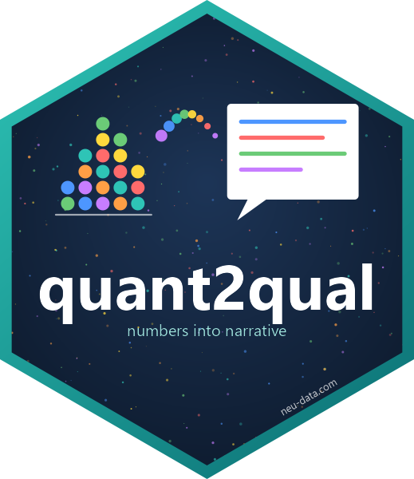

<div align="center">


</div>

# quant2qual 

<!-- badges: start -->
[](https://github.com/neu-data/quant2qual/actions/workflows/R-CMD-check.yaml)
[](https://neu-data.github.io/quant2qual/)
[](https://lifecycle.r-lib.org/articles/stages.html#experimental)

<!-- badges: end -->

**The Automated Behavioral Narrator: turn behavioral metrics into qualitative case-study prose.**

Packages such as `gtsummary` and `summarytools` turn numbers into excellent
tables. `quant2qual` turns them into *words*: it reads numeric distributions of
time, activity and friction -- clickstreams, app metrics, learning-platform
logs, survey paradata -- classifies every case into a behavioral archetype, and
writes the clinical or UX case study that a researcher would otherwise draft by
hand. Every sentence cites its own evidence and states its own uncertainty.

It is rule-based and fully local: no API, no language model, and the same data
always produce the same text.

## Installation

```r
# install.packages("remotes")
remotes::install_github("neu-data/quant2qual")
```

## The pipeline

```
q2q_lexicon() + default_archetypes() [+ define_archetype()]   configure the domain once
        |
identify_archetype()  ->  archetype_summary()                  scale, band, match
        |
select_cases()  ->  generate_narrative()                       write the case studies
                ->  generate_cohort_narrative()                and the cohort synthesis
        |
write_behavioral_report()  ->  Markdown | R Markdown | Quarto | HTML | PDF
```

The same workflow is set out page by page in
**[the pipeline guide](inst/pipeline/quant2qual-pipeline.pdf)** -- nine pages,
typeset with the Neudata PDF template, every figure computed from the synthetic
example:

```r
plot_q2q_pipeline()     # the diagram
q2q_pipeline()          # the same thing as a table
rmarkdown::render(system.file("pipeline", "quant2qual-pipeline.Rmd", package = "quant2qual"))
```

## Example

```r
library(quant2qual)

users   <- mock_behavioral_data(200)   # user_id, active_minutes, action_clicks, error_count
profile <- identify_archetype(users)   # scale, band and match every user
summary(profile)
#>   archetype               n share mean_confidence
#> 1 Frustrated Fighter     19 0.095           0.965
#> 2 Frustrated Novice      19 0.095           0.915
#> 3 Methodical Explorer    39 0.195           0.956
#> 4 Power Navigator        30 0.15            0.936
#> 5 Passive Disengaged     46 0.23            0.953
#> 6 Baseline User          47 0.235           0.730

generate_narrative(profile, id = 294)
```

> **Case Study ID: #294** -- *Frustrated Fighter -- Obstructed persistence*
>
> **Presenting pattern.** The participant exhibited a state of high interaction
> friction. The profile maps onto the Frustrated Fighter archetype -- an engaged
> but deeply stuck user struggling against system barriers, exhibiting high
> friction and repetitive loops.
>
> **Behavioral evidence.** Interaction volume was far above the cohort norm at
> 208 actions (roughly four times the cohort median; z = +2.75), consistent with
> heavy, sustained interaction with the interface. Compounding this, at 15
> errors, error events placed the participant above 95% of the cohort (about 8
> times the cohort median; z = +2.70), a pattern that points to persistent
> friction at the level of the interface. Likewise, at 53.5 minutes, session
> duration placed the participant above 90% of the cohort ... In relative terms,
> the record shows an interaction cadence of 3.9 actions per minute and an error
> rate of 7.2 errors per 100 actions (about 61% above the cohort median). On
> interaction volume and error events, the participant lies beyond the Tukey
> fence of the cohort distribution and is a statistical outlier ...
>
> **Interpretation.** Taken together, the profile describes effortful
> persistence under obstruction rather than disengagement ...
>
> **Confidence and caveats.** Classification confidence is high (membership
> 1.00) ... All comparisons are relative to the present cohort of 200
> participants (z scaling); the same raw values could read differently against
> another reference group.

```r
generate_narrative(profile, id = 104, style = "brief")   # one paragraph
generate_narrative(profile, id = 104, style = "ux")      # practitioner register
generate_cohort_narrative(profile)                       # the cohort synthesis

write_behavioral_report(profile, file = "study.pdf", format = "pdf",
                        title = "Checkout usability study", client = "Example Ltd")
```

## Optional: LLM narratives

The rule-based narrator is the default and needs nothing external. For more
varied prose, `generate_llm_narrative()` hands each case's fact sheet and
rule-based draft to a language model through
[ellmer](https://ellmer.tidyverse.org) and gets the same five sections back:

```r
# Claude by default (needs ANTHROPIC_API_KEY)
generate_llm_narrative(profile, id = 294)

# or any ellmer chat, including a local model
generate_llm_narrative(profile, id = 294, chat = ellmer::chat_ollama(model = "llama3.2"))

# in a report; the methods section records the narrator and model
write_behavioral_report(profile, format = "pdf", narrator = "llm")
```

The model sees only the case's derived statistics (`narrative_facts(profile, 294)`
shows exactly what is sent), is told to cite nothing else, and every number in
its output is checked against the fact sheet. If a call fails, the rule-based
narrative is used instead.

## The archetype matrix

Three dimensions, standardised against the cohort so that "high" always means
high *for this dataset*:

| Archetype | Velocity (time) | Intensity (actions) | Friction (errors) | Persona |
|---|---|---|---|---|
| Frustrated Fighter | mid/high | high | high | An engaged but deeply stuck user struggling against system barriers. |
| Frustrated Novice | low/mid | low/mid | high | A newcomer who meets friction early and leaves before finding a footing. |
| Methodical Explorer | high | low/mid | low/mid | A careful, systematic user who reads thoroughly and moves intentionally. |
| Power Navigator | low/mid | high | low/mid | A proficient power user who sweeps through workflows with surgical precision. |
| Passive Disengaged | low | low | low/mid | A distracted user who skims the surface and exits quickly. |
| Baseline User | fallback | | | A user whose behavior sits within the ordinary range of the cohort. |

Bands default to +/- 0.5 SD and can be set per dimension, replaced by raw-unit
`cutpoints`, or computed on robust (median/MAD) or rank-based scores. Every
case also gets a fuzzy **membership** in every archetype, which becomes its
**confidence** and names its **runner-up**, so borderline cases are reported as
borderline. Define your own signatures with `define_archetype()`.

## Three domains

| Domain | Subject | Velocity | Intensity | Friction | Archetypes |
|---|---|---|---|---|---|
| `"ux"` | participant | session duration | interaction volume | error events | Frustrated Fighter, Methodical Explorer, Power Navigator, ... |
| `"learning"` | learner | time on task | learning activity | failed attempts | Struggling Persister, Deep Learner, At-Risk Withdrawer, ... |
| `"survey"` | respondent | completion time | open-text elaboration | data-quality flags | Careless Speeder, Deliberative Responder, Effortful Struggler, ... |

Each pack carries its own vocabulary, interpretations and recommendations, and
every piece of it can be overridden with `q2q_lexicon()`.

## Reports

`write_behavioral_report()` compiles key findings, the cohort synthesis with
figures, one case study per selected case and an automatically written methods
section into:

| Format | Output |
|---|---|
| `"markdown"` | pandoc Markdown text or file |
| `"rmd"` | R Markdown source rendering with `quant2qual::neudata_pdf` |
| `"qmd"` | Quarto source (HTML and PDF) |
| `"html"` | self-contained HTML in the Neudata palette |
| `"pdf"` | PDF typeset with the Neudata LaTeX class (cover page, branded headers, key-finding boxes, copyright page) |

`neudata_pdf()` is an ordinary R Markdown output format, so the house style is
available to any document. In RStudio, **File > New File > R Markdown > From
Template > quant2qual behavioral report** starts a parameterised study report.

## Design principles

* **Cohort-relative.** Thresholds scale to the data; fixed cutpoints are opt-in.
* **Transparent.** Rules are a readable matrix; the methods section of every
  report states the scaling, the band edges in raw units and the matrix.
* **Honest about uncertainty.** Confidence, runner-up archetypes and outliers
  are part of the prose, not hidden in a column.
* **Deterministic and local.** No external service; identical input, identical
  text.

## Learn more

* `vignette("quant2qual")` -- getting started
* `vignette("archetype-engine")` -- scaling, thresholds, membership and custom archetypes
* `vignette("domains")` -- learning analytics, survey paradata, custom vocabularies
* `vignette("reports")` -- report formats and the PDF house style

---

<div align="center">

**Neudata Consulting Ltd** · *Insight. Impact. Innovation.*
[www.neu-data.com](https://www.neu-data.com) · [contact@neu-data.com](mailto:contact@neu-data.com)

</div>
